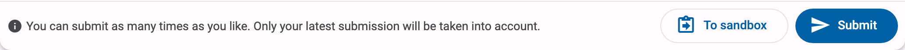
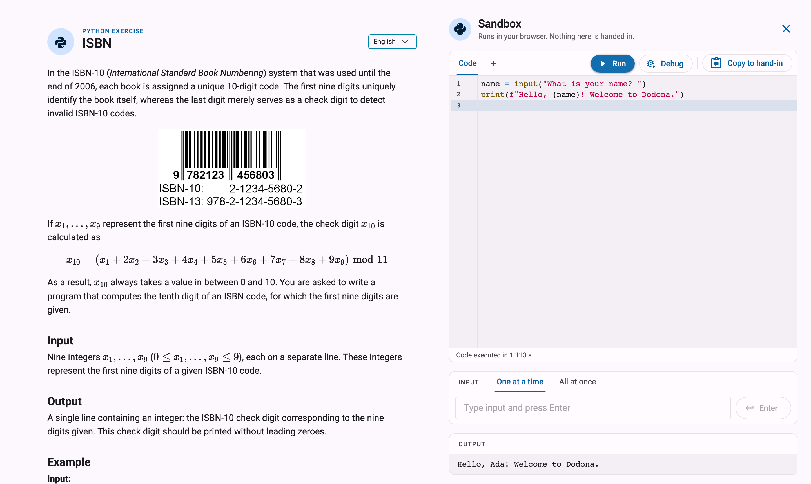
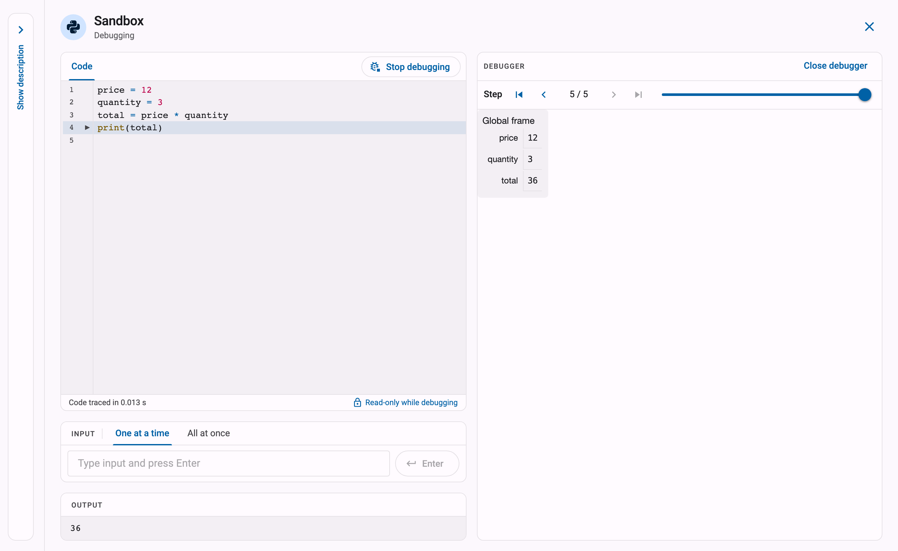
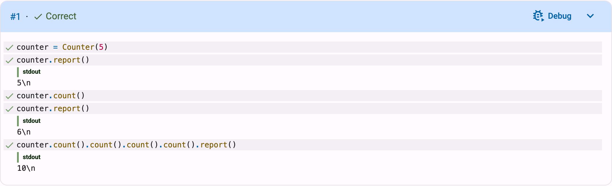

# The Python Sandbox
For Python exercises, Dodona has a built-in **sandbox**: a place in which you can write and run Python code directly in your browser, without installing anything on your computer. The sandbox is ideal for quickly trying something out: experiment with a few lines of code, test your solution with your own input, or step through your program with the built-in debugger to see exactly what it does. Code you run in the sandbox is **not** submitted to Dodona and is not evaluated by the judge; when you are happy with your code, you submit it in the usual way, as explained in [Solving Exercises](../exercises/).

## Opening the Sandbox

The sandbox is available on the page of every Python exercise. At the bottom of the panel where you submit your solution, next to the submit button, you will find the `To sandbox` button. You can also open it with `Open sandbox` in the `On this page` list on the right of the exercise page.

On a wide screen, the `Sandbox` opens in a column on the right of the exercise page, next to the description. The description keeps its place, so you can keep reading the assignment while you write your code. Meanwhile, the series list on the left shrinks to a narrow column with the status of each activity; the button at its top (`Show the series`) shows the full list over the page. Close the sandbox with the close button in its top right corner (`Close the sandbox`).

The sandbox contains a **code editor** with a `Run` button, a field to provide **input**, and the **output** of your code.

On a phone or a narrow window, the sandbox opens as a panel that slides up from the bottom of the screen. Tap the dimmed page above it, or use the close button, to close it again.

If you had already written code in the editor of the exercise page, the sandbox automatically starts from that code. If the sandbox already contains different code from an earlier session, Dodona first asks whether you want to overwrite it with your latest changes.

::: tip The first run can take a moment
The sandbox runs Python entirely in your browser. The first time you run code, your browser still has to download and start the Python environment, so it can take a little while before you see any output. Subsequent runs are much faster.
:::

## Running Code

Write your code in the editor and click `Run`. The output of your program appears in the output panel below. While your code is running, you can interrupt it at any time with the `Stop` button.

Some more things the sandbox can do:

- **Input**: if your program reads input (for example with `input()`), you can simply type your answer in the input field when your program asks for it, and press enter. Prefer to prepare all input beforehand? The input panel has two tabs: on `One at a time` you answer each question at the moment your program asks it, and on `All at once` you enter all input lines in advance.
- **Turtle graphics**: if your code draws with the `turtle` module, the drawing appears in a separate `Turtle` tab next to the textual output.
- **Packages**: when your code imports a package, the sandbox automatically tries to install it. Most commonly used packages work; packages that need access to your operating system do not work in the browser.
- **Files from the exercise**: files that come with the exercise can be loaded into the sandbox automatically. You can also drag files from your computer onto the code editor to use them in your code.

## Submitting Your Code

Code in the sandbox is never submitted automatically. Once your code does what you want, click `Copy to hand-in`: this copies your code from the sandbox to the editor of the exercise page, closes the sandbox and takes you to that editor, where you can review your code one last time and submit it. Only then is your solution evaluated by the judge, as described in [Understanding Feedback](../feedback/).

::: warning Sandbox code is not saved
Dodona does not store the code you write in the sandbox. If you close the page without copying your code to the editor and submitting it, your work may be lost. Submit regularly!
:::

## Debugging Step by Step

The sandbox also contains a **debugger** (based on the well-known Python Tutor) that executes your program step by step. This is very useful if your program does something different from what you expected: instead of guessing, you can watch exactly what happens at each step.

Click the `Debug` button next to `Run` to start the debugger. The debugger appears next to your code (or below it, when there is not enough room). On a wide screen, the exercise description folds into a narrow `Show description` tab on the left to make room. Click that tab to show the description again, and `Collapse description` to fold it away; Dodona remembers your choice for the next time you debug. In the debugger, you can walk through your program:

- Drag the **slider** to move through the steps of your program, or use the arrow buttons to go to the previous, next, first or last step.
- At each step, the debugger shows which line is being executed and how your program builds and stores information: the variables that exist at that point and their values.
- Click `Stop debugging` to end the run. The debugger stays open, so you can start it again with `Debug` without anything on the page moving.
- Click `Close debugger` to go back to the normal layout of the sandbox.

### Debugging a Failed Test Case

You can also start the debugger straight from the feedback on a submission. On the feedback page of a Python exercise, test cases show a `Debug` button. Clicking it opens the sandbox with the code of your submission, runs that specific test case with the same input the judge used, and starts the debugger. The top of the sandbox says which test you are debugging (for example `Debugging test #1`), and with the debugger, under `Test case being debugged`, you can see the test case itself. This way you can follow, step by step, exactly where your submission goes wrong for a failed test.

## Limitations

The sandbox is a tool for experimenting, not a replacement for submitting:

- Your code runs in your browser, not in the environment the judge uses. Running code in the sandbox never produces a submission, and only the judge determines whether your solution is correct.
- Not all packages are available in the browser, and heavy computations may run slower than on the judge.
- Sandbox code is not saved by Dodona: copy your code to the editor and submit it to keep it.

The sandbox is only available for **Python** exercises. For other programming languages, we recommend working in an [IDE](../exercises/#submitting-a-solution) and submitting your solution on Dodona.
